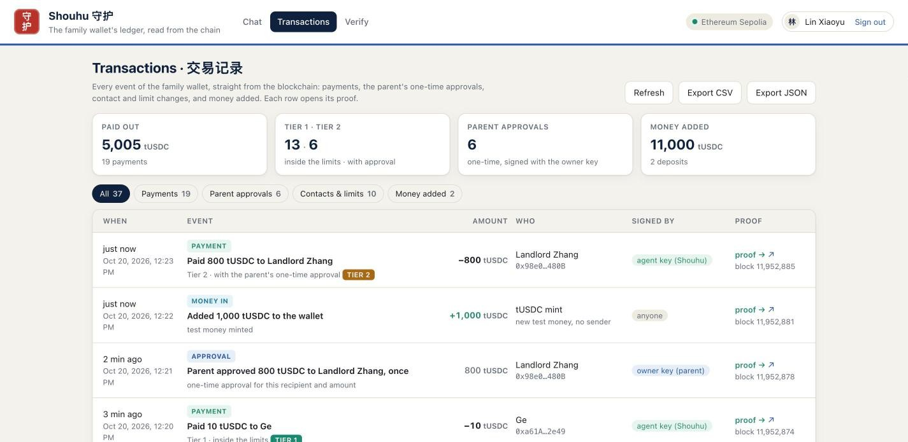
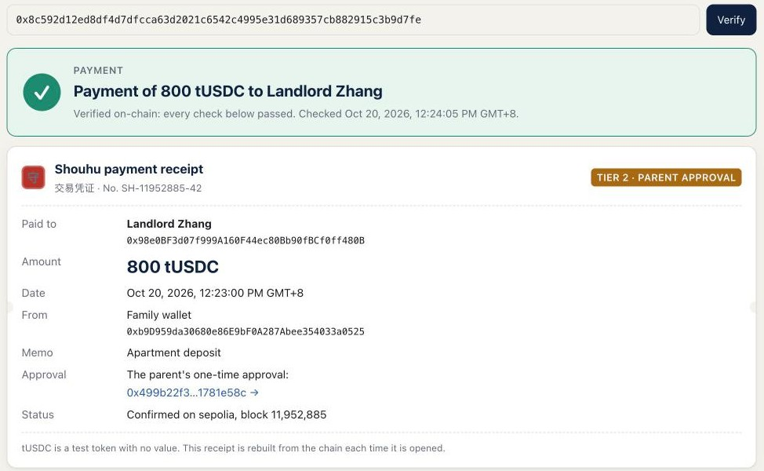

# Shouhu 守护 — Execution Evidence

**Execution evidence: real on-chain transaction hashes on Ethereum Sepolia**

2026 Shenzhen International FinTech Competition (FinTechathon) · International Track · Topic F: Agent Wallet — Autonomous On-chain Wallet  
Team Shouhu · De La Salle University Manila · Yohann Manuel Miranda (team leader), Aleana Sia, Weihong Chen, Aaron Hester Chong, Jon Austin Lin  
Version 1.1 · 20 October 2026, revised after an adversarial review · read from the chain on 2026-10-20 20:47 UTC+8 (Beijing time), block 11,955,376  

**Evidence at a glance**

- **Network and contracts:** Ethereum Sepolia (chain id 11155111). PolicyWallet [`0xb9D959da30680e86E9bF0A287Abee354033a0525`](https://sepolia.etherscan.io/address/0xb9D959da30680e86E9bF0A287Abee354033a0525) and TestUSDC [`0x6b2f3F61DB4e45D07453D58dF2F4eB27C5284931`](https://sepolia.etherscan.io/address/0x6b2f3F61DB4e45D07453D58dF2F4eB27C5284931), both source-verified on Sourcify (exact match of the creation and runtime bytecode).
- **49 transactions, all listed:** 46 with the two contracts (2 deployments, 9 allowlist changes, 2 deposits of test money (11,000 tUSDC), 7 one-time owner approvals, **23 payments by the AI agent (16 Tier 1 inside the limits, 7 Tier 2 with the parent’s approval)** and **3 transactions the contract rejected**), plus 3 transfers of test ether for gas. The owner key has signed 22 transactions and the agent key 26 (their nonces), and every one is here.
- **Traceable:** each of the 23 payments carries an intent id that identifies its policy decision in the committed audit log; the decision’s amount, recipient and tier match the payment in all 23.
- **Checked twice:** the app’s proof checks pass for every wallet transaction (41 of 41), and a separate script that does not use the app’s code passed all 644 checks on 20 October at 20:55 UTC+8. Balance 5,150 tUSDC = 11,000 deposited − 5,850 paid; no payment outside policy.
- **Machine-readable:** `transactions.csv` and `transactions.json` (every hash with its Etherscan and Blockscout links), `proof_checks.json`, `rejections.json`, `verify_all_payments.txt`, `audit_log.jsonl`, and the re-check `check_onchain.py` with its output `independent_check.txt`.

> Every payment the agent made is on-chain, inside the parent’s policy, and linked to the student’s request and the policy decision behind it. The contract refused all three deliberate attempts to go around the policy.

A print version of this report is in [`Shouhu_Execution_Evidence.pdf`](Shouhu_Execution_Evidence.pdf).

**Contents:** [1. How to check any hash](#1-how-to-check-any-hash) · [2. Deployment and setup](#2-deployment-and-setup) · [3. Payments by the AI agent](#3-payments-by-the-ai-agent) · [4. Transactions the contract rejected](#4-transactions-the-contract-rejected) · [5. Rule changes and deposits](#5-rule-changes-and-deposits) · [6. Runs that produced the transactions](#6-runs-that-produced-the-transactions) · [7. Independent re-check](#7-independent-re-check) · [8. Live app screenshots](#8-live-app-screenshots) · [9. Files and other evidence](#9-files-and-other-evidence) · [10. Revision note (version 1.1)](#10-revision-note-version-11) · [Appendix. Every transaction](#appendix-every-transaction)

## 1. How to check any hash

1. Open the hash on Etherscan (every hash in this report links there). Check **Status: Success**, **From** (the agent key `0xe46A…b291` or the owner key `0x4444…9EEF`) and **To** the PolicyWallet. Under **Logs**, Etherscan names the tUSDC `Transfer` but shows the PolicyWallet’s own event as a raw log, because the contract is verified on Sourcify, not on Etherscan. Topic 0 tells which event it is: `0xa25ccf32…` is `Payment` (topic 1 the intent id, topic 2 the recipient, topic 3 the signer; the data holds the amount in base units, 6 decimals, and whether an approval was used) and `0xd896bfbc…` is `ApprovalGranted`.
2. For the decoded view, open the same hash on Blockscout (`https://eth-sepolia.blockscout.com/tx/<hash>`; the appendix links each one). Blockscout reads the Sourcify verification and shows `Payment(intentId, to, amount, by, viaApproval)`, `ApprovalGranted` and the revert reason of a rejected transaction by name.
3. Compare the contract source on Sourcify ([PolicyWallet](https://repo.sourcify.dev/11155111/0xb9D959da30680e86E9bF0A287Abee354033a0525), exact match) with `contracts/src/PolicyWallet.sol` in the repository.
4. Link a payment to its decision. The intent id is the keccak-256 hash of four fields of the decision entry in `evidence/runs/sepolia-20261020-181247/audit_log.jsonl`: session, sequence number, event name and time (Python `json.dumps` of those fields with sorted keys). `uv run shouhu-verify --chain sepolia <hash>` does this and prints the student’s words, the decision, its tier and reasons. The hash identifies the entry but does not seal its text (security self-assessment, risk R25), so compare the decision’s amount and recipient with the payment itself, as the re-check in section 7 does.
5. Re-run every check in this report with one command from the repository root: `uv run python evidence/onchain/check_onchain.py` (section 7).
6. Ask the live contract directly, with no keys: `uv run shouhu-try --chain sepolia mama 600` answers REJECTED (`ExceedsPerTransferCap`).

Repository: [https://github.com/SeerieTheGreat/AIAgent](https://github.com/SeerieTheGreat/AIAgent). Contract addresses: PolicyWallet [`0xb9D959da30680e86E9bF0A287Abee354033a0525`](https://sepolia.etherscan.io/address/0xb9D959da30680e86E9bF0A287Abee354033a0525), TestUSDC [`0x6b2f3F61DB4e45D07453D58dF2F4eB27C5284931`](https://sepolia.etherscan.io/address/0x6b2f3F61DB4e45D07453D58dF2F4eB27C5284931), owner key `0x4444b10a36E88682C63caE89E2ADb561651e9EEF`, agent key `0xe46Ab06dF31a8E03BAAe6aA5912b60B10e0Fb291`.

## 2. Deployment and setup

| Time (UTC+8) | What happened | Signed by | Transaction |
|---|---|---|---|
| 10-16 18:14 | 0.05 ETH of test ether from a Sepolia faucet to the owner key | Sepolia faucet (not a team key) | [`0x5bf55810…41ab1f`](https://sepolia.etherscan.io/tx/0x5bf5581063d1656566378996efd5fe1ae4debd08027325fdbb2c261da241ab1f) |
| 10-16 18:15 | deploy TestUSDC (0x6b2f3F61…) | owner key (parent) | [`0x09fc9fe7…fdaee2`](https://sepolia.etherscan.io/tx/0x09fc9fe7db1c0febd1a793932804f9ffb05b4f87d8639ba3f64ce40b56fdaee2) |
| 10-16 18:15 | deploy PolicyWallet (0xb9D959da…) | owner key (parent) | [`0xa858a9a4…f6d9b9`](https://sepolia.etherscan.io/tx/0xa858a9a45f83dc612b81984473310fd179ae6adc4fe40fbe96a086b27ff6d9b9) |
| 10-16 18:15 | AgentUpdated: agent key 0xe46Ab06dF31a8E03BAAe6aA5912b60B10e0Fb291 | owner key (parent) | [`0xa858a9a4…f6d9b9`](https://sepolia.etherscan.io/tx/0xa858a9a45f83dc612b81984473310fd179ae6adc4fe40fbe96a086b27ff6d9b9) |
| 10-16 18:15 | PolicyUpdated: limits 500 tUSDC per transfer, 1,000 tUSDC per 24 hours | owner key (parent) | [`0xa858a9a4…f6d9b9`](https://sepolia.etherscan.io/tx/0xa858a9a45f83dc612b81984473310fd179ae6adc4fe40fbe96a086b27ff6d9b9) |
| 10-16 18:16 | Transfer into the wallet (test money minted): 10,000 tUSDC into the PolicyWallet | owner key (parent) | [`0x14d03120…e45df2`](https://sepolia.etherscan.io/tx/0x14d0312002dc2603273242ca748357759d98d72afd2ae92d7ef31dce97e45df2) |
| 10-16 18:16 | AllowlistUpdated: Mama added to the allowlist | owner key (parent) | [`0xd1c15e59…1c43dc`](https://sepolia.etherscan.io/tx/0xd1c15e59ae425feb4467ba362afa7b6240a1232bb9b8b455ab9fbd8d121c43dc) |
| 10-16 18:16 | AllowlistUpdated: Ge added to the allowlist | owner key (parent) | [`0xb66b24a2…5de605`](https://sepolia.etherscan.io/tx/0xb66b24a26b7d8d7e5f1f85608767f7543dd8f4e24c93da59354a51e2965de605) |
| 10-16 18:16 | AllowlistUpdated: Landlord Zhang added to the allowlist | owner key (parent) | [`0x9a886db8…6c35fb`](https://sepolia.etherscan.io/tx/0x9a886db8a557953990825e8ec61c4ca5a11044b37cdec81ea3a099427f6c35fb) |
| 10-16 18:16 | AllowlistUpdated: University Bursar added to the allowlist | owner key (parent) | [`0xbce911f4…29483e`](https://sepolia.etherscan.io/tx/0xbce911f4158555460d4e6953de4d43920b3d23538ead83ee760677713f29483e) |
| 10-16 18:17 | AllowlistUpdated: Xiao Wang added to the allowlist | owner key (parent) | [`0x19c6182f…63cd48`](https://sepolia.etherscan.io/tx/0x19c6182fa9a1f2240d26f5e512c5ff07714b51d7d4685c24642c0001e663cd48) |
| 10-16 18:17 | 0.012 ETH of test ether from the owner key to the agent key: ran out of gas (limit 21,000; a transfer to a new address used 204,600 gas on Sepolia), nothing moved | owner key (parent) | [`0x459013ac…6f9ed4`](https://sepolia.etherscan.io/tx/0x459013ac4f71a68dd0ed40018798bbdc27fec347a041e597c301fe7a526f9ed4) |
| 10-16 18:20 | 0.012 ETH of test ether from the owner key to the agent key (resent with a higher gas limit) | owner key (parent) | [`0x8e043a84…46864b`](https://sepolia.etherscan.io/tx/0x8e043a840e9c29e72320e815672bf965c65fa08881806a41e478d7785b46864b) |

The PolicyWallet constructor set the agent key and the limits (500 tUSDC per transfer, 1,000 tUSDC per 24 hours) in its deployment transaction. The owner then minted 10,000 tUSDC of test money into the wallet, allowlisted the five default contacts and sent the agent key test ether for gas. The first gas transfer used the usual 21,000 gas limit and failed: both transfers to a new address in this table used 204,600 gas on Sepolia, so it was resent with a higher limit. TestUSDC’s `mint` is open to anyone, as befits a test token; both mints in this report were sent by the owner key.

## 3. Payments by the AI agent

### 3.1 Tier 1: inside the parent’s limits (16 payments)

Signed by the agent key with `agentTransfer`. The policy engine allowed each one, and the contract re-checked the allowlist, the per-transfer cap and the rolling 24-hour cap.

| Time (UTC+8) | Payment | The student’s words | Transaction |
|---|---|---|---|
| 10-16 18:25 | 20 tUSDC to Mama | “Send 20 USDC to Mama.” | [`0xb9ee7295…520074`](https://sepolia.etherscan.io/tx/0xb9ee729554fc96d3c00ce465bd83f2702955a4dc914d1953b602444592520074) |
| 10-16 18:27 | 10 tUSDC to Ge | “给哥转 10 USDC” | [`0xbb784709…a5dc7c`](https://sepolia.etherscan.io/tx/0xbb784709c0dcb2a82d8289ffd175305896e7839a1c85d327f886e227f1a5dc7c) |
| 10-19 15:18 | 20 tUSDC to Mama | “Send 20 USDC to Mama.” | [`0x3330ce7a…45ca06`](https://sepolia.etherscan.io/tx/0x3330ce7a8b2fd8d8cca4ecbb914c803385ae73677636e151be0066988545ca06) |
| 10-19 15:20 | 10 tUSDC to Ge | “给哥转 10 USDC” | [`0xe50ff1be…ed42aa`](https://sepolia.etherscan.io/tx/0xe50ff1be2e6638fa55e1d87922f0e3dce37195fc2b6821e66195b26651ed42aa) |
| 10-20 01:37 | 20 tUSDC to Mama | “Send 20 USDC to Mama.” | [`0xe21b79ff…b5363f`](https://sepolia.etherscan.io/tx/0xe21b79ff273815d9c72cd1f57185024993a1747894abeba8367ae12419b5363f) |
| 10-20 01:42 | 10 tUSDC to Ge | “给哥转 10 USDC” | [`0x0352e2f7…3cc6c7`](https://sepolia.etherscan.io/tx/0x0352e2f70339d7045fbeaef5fa7cfd527122af87449c5ce84434dbcef23cc6c7) |
| 10-20 06:51 | 15 tUSDC to Aunt Li 李阿姨 | “给李阿姨转 15 USDC” | [`0x4830a81f…c8c332`](https://sepolia.etherscan.io/tx/0x4830a81f1e1d1e8e872ee4964a1b8cbc52fb7593f3ec87726a6afc67e1c8c332) |
| 10-20 07:00 | 20 tUSDC to Mama | “Send 20 USDC to Mama.” | [`0x9d9d76a5…247ffb`](https://sepolia.etherscan.io/tx/0x9d9d76a59ac88348e32915235b80866cf7e28457a38a9cbe73f26ab287247ffb) |
| 10-20 07:02 | 15 tUSDC to Aunt Li 李阿姨 | “给李阿姨转 15 USDC” | [`0xb8a35a26…e23213`](https://sepolia.etherscan.io/tx/0xb8a35a263a31ff7c7e4a1e251442f6068c504ede4e4f21281f19cae1e4e23213) |
| 10-20 07:05 | 20 tUSDC to Mama | “Send 20 USDC to Mama.” | [`0x2f126f72…af39ce`](https://sepolia.etherscan.io/tx/0x2f126f72298d101555f5089a8504141fbf39be570c895c2459b32f1ab6af39ce) |
| 10-20 07:10 | 15 tUSDC to Aunt Li 李阿姨 | “给李阿姨转 15 USDC” | [`0x53f802b5…d3c0a3`](https://sepolia.etherscan.io/tx/0x53f802b50f4715201f67b1f1f711b4f6909571aeb98381fc8756b90e9dd3c0a3) |
| 10-20 12:19 | 20 tUSDC to Mama | “Send 20 USDC to Mama.” | [`0xc4007a1c…c51859`](https://sepolia.etherscan.io/tx/0xc4007a1c97eb5da64abc8b6d710bc879fa0ec5bc5424f0387f8fe9adc2c51859) |
| 10-20 12:20 | 10 tUSDC to Ge | “给哥转 10 USDC” | [`0xe4e2a1f3…79a81b`](https://sepolia.etherscan.io/tx/0xe4e2a1f361a091a60fa8c4dd08bd9177a6a0c8cc1137cc1b592bf51a0879a81b) |
| 10-20 12:28 | 15 tUSDC to Aunt Li 李阿姨 | “给李阿姨转 15 USDC” | [`0x62e6726e…45ac3f`](https://sepolia.etherscan.io/tx/0x62e6726e214c02e5fe7ad8dd6e7678f16a86dc8de0ee308aa9378c045345ac3f) |
| 10-20 17:53 | 20 tUSDC to Mama | “Send 20 USDC to Mama.” | [`0xe2dbb06c…67e502`](https://sepolia.etherscan.io/tx/0xe2dbb06cd1d699ba135ef11232c766f5a22c440b3542abc9b9a17eb0bd67e502) |
| 10-20 17:55 | 10 tUSDC to Ge | “给哥转 10 USDC” | [`0x5f3bbedc…8a517d`](https://sepolia.etherscan.io/tx/0x5f3bbedca4e630015ba51820660304dc5c5f47badde580cd7ec71504178a517d) |

### 3.2 Tier 2: with the parent’s one-time approval (7 payments)

Each request went above the 500 tUSDC per-transfer cap, so the policy engine filed it for the parent. The parent approved exactly that recipient and amount once with the owner key (`approveOnce`), and the agent then executed it with `agentTransferWithApproval`, which marks the approval used.

| Time (UTC+8) | Payment | The student’s words → reason for approval | Parent’s approval | Payment |
|---|---|---|---|---|
| 10-16 18:26 | 800 tUSDC to Landlord Zhang | “Pay the landlord 800 USDC for the apartment deposit.” → 800 tUSDC exceeds the per-transfer cap of 500 tUSDC | [`0xd4961bcc…4b0509`](https://sepolia.etherscan.io/tx/0xd4961bcc9dd7fc245bb69baceb04673e2c7095877499c675fac27dbacc4b0509) | [`0x838aee65…a38cfc`](https://sepolia.etherscan.io/tx/0x838aee659579417aa92716e84790bb07158e68f6fbb77b11fb20936e46a38cfc) |
| 10-19 15:19 | 800 tUSDC to Landlord Zhang | “Pay the landlord 800 USDC for the apartment deposit.” → 800 tUSDC exceeds the per-transfer cap of 500 tUSDC | [`0x16f6267e…dc96d1`](https://sepolia.etherscan.io/tx/0x16f6267ee9394bfe52cee8c77d7d48ca76253609482abeb1b197ef8842dc96d1) | [`0x4d6b84ae…87ab48`](https://sepolia.etherscan.io/tx/0x4d6b84aec33229f1d50ec07da161d54702c546773048b7289f6e6e451187ab48) |
| 10-20 01:39 | 800 tUSDC to Landlord Zhang | “Pay the landlord 800 USDC for the apartment deposit.” → 800 tUSDC exceeds the per-transfer cap of 500 tUSDC | [`0x18fa60fe…aafaa2`](https://sepolia.etherscan.io/tx/0x18fa60fe57de1bb73d5b7ddac8c9e4b6c542e0320c57fae46e2696370faafaa2) | [`0xf729b1d8…f5aa68`](https://sepolia.etherscan.io/tx/0xf729b1d85a840532167add73cacb484ecbeebfde67ad91a2d581a6c37bf5aa68) |
| 10-20 07:01 | 800 tUSDC to Landlord Zhang | “Pay the landlord 800 USDC for the apartment deposit.” → 800 tUSDC exceeds the per-transfer cap of 500 tUSDC | [`0x4a0f6659…c18c27`](https://sepolia.etherscan.io/tx/0x4a0f66598463d333080aa76f5c24239731145431e898f27adca21be86cc18c27) | [`0xc4805f36…e8b8ba`](https://sepolia.etherscan.io/tx/0xc4805f36ca0d8e736662b84097f3fb0e5f2483c6e80b89deadb84c53e8e8b8ba) |
| 10-20 07:08 | 800 tUSDC to Landlord Zhang | “Pay the landlord 800 USDC for the apartment deposit.” → 800 tUSDC exceeds the per-transfer cap of 500 tUSDC | [`0x8d783a7b…d636a7`](https://sepolia.etherscan.io/tx/0x8d783a7b439c3bc83a5ce1ab23ec1e47b7412c5b1533708bf25856ce4cd636a7) | [`0xdec61abe…ab1377`](https://sepolia.etherscan.io/tx/0xdec61abe7b51de693b79f497e3c677fce111c299a19eec04beeb0ae601ab1377) |
| 10-20 12:23 | 800 tUSDC to Landlord Zhang | “Pay the landlord 800 USDC for the apartment deposit.” → 800 tUSDC exceeds the per-transfer cap of 500 tUSDC | [`0x499b22f3…81e58c`](https://sepolia.etherscan.io/tx/0x499b22f3d79ac2119ecbb2bfb730be94f316ad36db2dd92f1448ba281781e58c) | [`0x8c592d12…b9d7fe`](https://sepolia.etherscan.io/tx/0x8c592d12ed8df4d7dfcca63d2021c6542c4995e31d689357cb882915c3b9d7fe) |
| 10-20 17:54 | 800 tUSDC to Landlord Zhang | “Pay the landlord 800 USDC for the apartment deposit.” → 800 tUSDC exceeds the per-transfer cap of 500 tUSDC | [`0x7da07536…2a3a51`](https://sepolia.etherscan.io/tx/0x7da075360343b7c5ad0846376880123248ecac27c184ae0261bf6c777c2a3a51) | [`0x3b577f89…6d282e`](https://sepolia.etherscan.io/tx/0x3b577f89b3b46e565385ea3655036d2084b7108b357d5c26c39de47d136d282e) |

The approval and the payment share one intent id, and the same id identifies the policy decision in the audit log. All seven approvals are now marked used on-chain, each by exactly one payment of the approved amount to the approved recipient (checked again in section 7). A second attempt with the same approval reverts with `ApprovalUsed` (contract test `test_approvalFlow`).

## 4. Transactions the contract rejected

To show what happens if the software above the contract is bypassed or compromised, three transactions were sent directly with the agent key on 20 October 2026, skipping the policy engine and the app’s dry run. The contract rejected all three; nothing moved, and the wallet balance stayed at 5,980 tUSDC, its balance at the time. Together they cost 0.000068 test ETH in gas.

| Attempt by the agent key | Rejected with | Status | Transaction |
|---|---|---|---|
| 600 tUSDC to Mama (per-transfer cap is 500) | `ExceedsPerTransferCap(amount=600000000, cap=500000000)` | Failed (reverted) | [`0xd1a63517…4c2319`](https://sepolia.etherscan.io/tx/0xd1a63517dcae701846483ca8d4b65192f62400e44be3754166f48d7aae4c2319) · [Blockscout](https://eth-sepolia.blockscout.com/tx/0xd1a63517dcae701846483ca8d4b65192f62400e44be3754166f48d7aae4c2319) |
| 1 tUSDC to the scam address from attack A1 (not allowlisted) | `NotAllowlisted(to=0x9f9f9f9f9f9f9f9f9f9f9f9f9f9f9f9f9f9f9f9f)` | Failed (reverted) | [`0x6dbe08db…d8b31f`](https://sepolia.etherscan.io/tx/0x6dbe08db28f00badd416618c511e0105e187a994627657fc36ad64ea6fd8b31f) · [Blockscout](https://eth-sepolia.blockscout.com/tx/0x6dbe08db28f00badd416618c511e0105e187a994627657fc36ad64ea6fd8b31f) |
| setPolicy(10,000 / 100,000 tUSDC) signed by the agent key (only the owner may change limits) | `NotOwner()` | Failed (reverted) | [`0x5511583e…9b046a`](https://sepolia.etherscan.io/tx/0x5511583e2dbcf295efc7da7aaca70dcf50ea8d5dcf2eee79bd0bdff6459b046a) · [Blockscout](https://eth-sepolia.blockscout.com/tx/0x5511583e2dbcf295efc7da7aaca70dcf50ea8d5dcf2eee79bd0bdff6459b046a) |

Etherscan shows each of the three as **Fail** with “execution reverted” but without the reason, because it has not verified the contract; Blockscout decodes the custom error, for example `ExceedsPerTransferCap(amount 600000000, cap 500000000)`. Each reason was also confirmed by replaying the same call against the chain state of the block before (for example block 11,954,297); the replay was repeated on 20 October at 20:55 UTC+8 with the same three results.

- **Over the per-transfer cap:** the agent cannot pay more than 500 tUSDC at once, even to an allowlisted contact.
- **Not on the allowlist:** the agent cannot pay the scammer’s address from red-team attack A1.
- **Not the owner:** the agent key cannot raise its own limits; only the owner key can call `setPolicy`.

## 5. Rule changes and deposits

| Time (UTC+8) | What happened | Signed by | Transaction |
|---|---|---|---|
| 10-20 06:49 | Aunt Li 李阿姨 added to the allowlist | owner key (parent) | [`0x972f309e…debbbc`](https://sepolia.etherscan.io/tx/0x972f309e9a86e370d9e202fa9b6df604898ffb7a8921e9cac6e86b6a4adebbbc) |
| 10-20 07:02 | Aunt Li 李阿姨 added to the allowlist | owner key (parent) | [`0xb24f3b4a…207ef1`](https://sepolia.etherscan.io/tx/0xb24f3b4a34843475471046319085ae384727f16f6fa7eff0a9df36cc7a207ef1) |
| 10-20 07:09 | Aunt Li 李阿姨 added to the allowlist | owner key (parent) | [`0xabdbbde0…6cd419`](https://sepolia.etherscan.io/tx/0xabdbbde096a8f9589bea8a8229605b2ad6dfb19ded2f65c7779c4a33356cd419) |
| 10-20 12:22 | 1,000 tUSDC into the PolicyWallet | owner key (parent) | [`0x1d194ba7…a027c2`](https://sepolia.etherscan.io/tx/0x1d194ba7f67c36368c8000d7126b29926b8369fd77458502372c507bdba027c2) |
| 10-20 12:27 | Aunt Li 李阿姨 added to the allowlist | owner key (parent) | [`0x8fd10071…c69bc0`](https://sepolia.etherscan.io/tx/0x8fd10071ddee63b5ad12182cdf47abee3d22af18ae5133c2d5be4b5d02c69bc0) |

Aunt Li 李阿姨 was registered as a contact from the owner console in four runs of the web app. Each registration is an allowlist transaction signed by the owner key; all four set the same address (`0x94bE59B587e96079Fc17a9914331018CBe97fCAC`) to allowed, so the repeats changed nothing on-chain. The 1,000 tUSDC deposit is test money added from the owner console, a mint sent by the owner key.

## 6. Runs that produced the transactions

| When (UTC+8) | Run | Sessions in the audit log | Payments |
|---|---|---|---|
| 16 Oct 18:25–18:27 | Judge mode on Sepolia: the eight scripted tasks with the AI model (terminal); owner approval in a separate process. Bundle `evidence/runs/sepolia-20261016-182745-tasks/` | `demo-20261016-182524` | 3 (2 Tier 1, 1 Tier 2) |
| 19 Oct 15:18–15:20 | Demo-guide test: terminal chat on Sepolia with the owner command in a second terminal | `a9173e3a87b7` | 3 (2 Tier 1, 1 Tier 2) |
| 20 Oct 01:37–01:42 | Browser app, first version: student chat and owner console | `web-20261020-013640`, `web-20261020-014114` | 3 (2 Tier 1, 1 Tier 2) |
| 20 Oct 06:49–07:10 | Browser app with registration: contact registration (Aunt Li) and the proof page, then two rehearsals of the live demo | `web-20261020-064745`, `web-20261020-065946`, `web-20261020-070448` | 7 (5 Tier 1, 2 Tier 2) |
| 20 Oct 12:19–12:28 | Browser app v2: parent registration with the owner key, student invite, AI model and rules-only assistant, owner console approval, test money. Bundle `evidence/runs/sepolia-20261020-124109-web-v2/` | `web-20261020-121856`, `web-20261020-122020`, `web-20261020-122809` | 4 (3 Tier 1, 1 Tier 2) |
| 20 Oct 17:07–17:08 | Contract rejection tests with the agent key (section 4) | — | 0 (3 rejected) |
| 20 Oct 17:52–17:55 | Demo video, recorded live: parent registration, student invite, AI model and rules-only assistant, the parent’s approval in the owner console. Bundle `evidence/runs/sepolia-20261020-181247/` | `web-20261020-175236`, `web-20261020-175520` | 3 (2 Tier 1, 1 Tier 2) |

Every payment’s decision is in the committed audit log under the session ids above; `transactions.csv` gives the session and decision number for each payment.

The demo video (submission item 3) shows four of these transactions being made: the Tier 1 payment to Mama at 0:56–1:13 ([`0xe2dbb06c…67e502`](https://sepolia.etherscan.io/tx/0xe2dbb06cd1d699ba135ef11232c766f5a22c440b3542abc9b9a17eb0bd67e502)), the parent’s approval at 1:34–1:44 ([`0x7da07536…2a3a51`](https://sepolia.etherscan.io/tx/0x7da075360343b7c5ad0846376880123248ecac27c184ae0261bf6c777c2a3a51)), the Tier 2 payment at 1:55–2:02 ([`0x3b577f89…6d282e`](https://sepolia.etherscan.io/tx/0x3b577f89b3b46e565385ea3655036d2084b7108b357d5c26c39de47d136d282e)) and the rules-only payment to Ge at 2:37–2:47 ([`0x5f3bbedc…8a517d`](https://sepolia.etherscan.io/tx/0x5f3bbedca4e630015ba51820660304dc5c5f47badde580cd7ec71504178a517d)). The proof page and the decoded explorer view of the Tier 2 payment follow at 2:56–3:28.

## 7. Independent re-check

On 20 October 2026 at 20:55 UTC+8 every figure in this report was checked again by a separate script, `evidence/onchain/check_onchain.py`. It uses only raw JSON-RPC calls and its own event decoding, not the app’s code, so a bug in the app cannot hide itself; state checks are made at the collection block (11,955,376), so later activity does not change them. Anyone can run it from the repository root: `uv run python evidence/onchain/check_onchain.py`. Result: **644 checks passed, 0 failed** (`independent_check.txt`).

| Check | Result |
|---|---|
| Every listed transaction: status, block, time, sender, recipient, nonce, gas and fee, the function called, events, amounts, tiers and intent ids | 49 of 49 transactions match the chain |
| Completeness: transactions signed by the two keys, from their nonces | owner key 22, agent key 26; every one is listed |
| Balance of the wallet | 5,150 tUSDC = 11,000 deposited − 5,850 paid; every payment made by the agent key, none by the owner |
| Tier 2 approvals | 7 of 7 used, each by one payment of exactly the approved amount to the approved recipient |
| Allowlist and limits | 6 addresses allowlisted; 500 / 1,000 tUSDC as last set; not paused; owner and agent keys as deployed |
| Rejected transactions, replayed at the block before | the same three errors: `ExceedsPerTransferCap`, `NotAllowlisted`, `NotOwner` |
| Intent ids | 23 of 23 payments: the hash of a decision with the same amount, recipient, tier and words |
| Source code on Sourcify | exact match of the creation and runtime bytecode for both contracts |

Two further checks were made by hand on 20 October: Blockscout lists 43 transactions to the PolicyWallet and 3 to TestUSDC, all of them in this report, and neither key has contract code attached (both are plain accounts). The script was also run on a deliberately altered copy of the data (a changed amount, a changed sender, a hidden transaction and changed words) and reported all four.

## 8. Live app screenshots

*The Transactions page of the live app on 20 October 2026 at 12:23 UTC+8, before the last payment of that run (19 payments at the time): every event of the wallet read from the chain, with the signing key and a proof link for each. The app labels the deposit’s signer “anyone” because TestUSDC’s mint is open to anyone; this mint was sent by the owner key.*

*The proof page for the 800 tUSDC Tier 2 payment [`0x8c592d12…b9d7fe`](https://sepolia.etherscan.io/tx/0x8c592d12ed8df4d7dfcca63d2021c6542c4995e31d689357cb882915c3b9d7fe): every check passed, with the receipt number SH-11952885-42 (block 11,952,885, log 42) and a link to the parent’s one-time approval.*

## 9. Files and other evidence

| File (in this folder) | Contents |
|---|---|
| `transactions.csv`, `transactions.json` | All 51 records (49 transactions: 46 with the two contracts and 3 transfers of test ether for gas): time, block, event, amount, tier, signer, status, nonce, full hash, Etherscan and Blockscout links, intent id, the student’s words, the decision and its reasons, gas and fee |
| `proof_checks.json` | For each of the 46 transactions with the contracts, the checks of the app’s proof page (status, signer, target contract, token movement, tier, intent id to decision), with a summary on top; contract creations and the three rejected transactions are expected to fail the payment checks |
| `rejections.json` | The three rejected transactions with the decoded revert reason and the replay confirmation |
| `verify_all_payments.txt` | `shouhu-verify --chain sepolia --all` on a fresh copy of the public repository (20 October, 18:19 UTC+8): each payment, its events and its audit entry; then the three rejected transactions |
| `audit_log.jsonl` | The audit log of every run on the team’s computer, on Sepolia and on the local test chain, including the decisions behind all 23 Sepolia payments (the same file as `evidence/runs/sepolia-20261020-181247/audit_log.jsonl`) |
| `check_onchain.py`, `independent_check.txt` | The independent re-check (section 7) and its output on 20 October at 20:55 UTC+8 |

The same files are public in the repository under `evidence/onchain/` (there the audit log is read from the evidence bundle). Other evidence: the red-team results (`evidence/redteam_results.md`, `evidence/redteam_results_rules.md`, 8 of 8 in both modes), the scripted-task bundles with transcripts (`evidence/runs/`), and the fresh-copy test logs (`docs/test_results/`). The rules ask non-on-chain topics for sandbox operation logs and a demo video; both are included as well: the eight tasks and eight attacks run on a local test chain with no network (`docs/test_results/05_judge_mode_offline_8_tasks.txt`, `docs/test_results/06_red_team_rules_only_8_of_8.txt`, and the `anvil-*` bundles and transcripts in `evidence/runs/`), and the demo video shows the live run on Sepolia (section 6).

## 10. Revision note (version 1.1)

Version 1.0 was reviewed again from a sceptical reviewer’s point of view: every hash, number and sentence was checked against the chain with a separate script, against the explorers and against the audit log. These corrections were made:

| Where | Version 1.0 said | Corrected in version 1.1 |
|---|---|---|
| At a glance | 46 transactions: 2 deployments, 11 rule changes, 2 deposits, 7 approvals, 23 payments, 3 rejected (these add up to 48) | Two of those settings, the agent key and the limits, are made inside the PolicyWallet deployment: 46 = 2 + 9 allowlist changes + 2 + 7 + 23 + 3 |
| Section 2, appendix, data | All transactions of the deployment | Three transfers of test ether for gas were missing, one of them a failed owner-key transaction (out of gas); now listed, with completeness shown by the keys’ nonces (22 and 26) |
| Section 1 | Etherscan shows the `Payment` or `ApprovalGranted` event under Logs | Etherscan shows the PolicyWallet’s events as raw logs (topic hashes given); Blockscout shows them by name and is linked for every hash |
| Section 1 | The intent id is the hash of the policy decision | It is the hash of the decision entry’s session, sequence number, event name and time: it identifies the entry but does not seal its text |
| Section 4 | Etherscan may show the custom error as raw data | Etherscan shows only “execution reverted”; Blockscout decodes the error |
| Data files | Contract creations listed with a recipient | A contract creation has no recipient; the created address now has its own column |
| Appendix, data | The 12:23 Tier 2 payment had no memo | Its request carried the memo “Apartment deposit”, as its receipt shows |
| Section 5 | Aunt Li … is allowlisted once on-chain | All four allowlist transactions set the same address to allowed |
| Section 6 | One run from 01:37 to 07:10 | Two runs (the first browser version, then registration with two demo rehearsals), and the session ids of every run |
| Claim | The contract refused every attempt | The contract refused all three deliberate attempts |
| Section 8 | Deposit signer shown as “anyone” without comment | Explained: TestUSDC’s mint is open to anyone; the owner key sent this one |
| New | — | Independent re-check script and output (section 7); demo-video timecodes (section 6); sandbox logs (section 9) |

Nothing on the chain changed: every hash, amount, signer and status in version 1.0 was correct, and the totals of payments, approvals and rejections are the same.

## Appendix. Every transaction

All 49 transactions, oldest first, with full hashes: the 46 with the two contracts and the 3 transfers of test ether for gas. Each hash opens on Etherscan; “Blockscout” opens the decoded view.

| Time | Transaction | Key | Status | Hash |
|---|---|---|---|---|
| 10-16 18:14 | Gas: 0.05 ETH, faucet → owner key | faucet | Success | [`0x5bf5581063d1656566378996efd5fe1ae4debd08027325fdbb2c261da241ab1f`](https://sepolia.etherscan.io/tx/0x5bf5581063d1656566378996efd5fe1ae4debd08027325fdbb2c261da241ab1f) · [Blockscout](https://eth-sepolia.blockscout.com/tx/0x5bf5581063d1656566378996efd5fe1ae4debd08027325fdbb2c261da241ab1f) |
| 10-16 18:15 | deploy TestUSDC | owner key | Success | [`0x09fc9fe7db1c0febd1a793932804f9ffb05b4f87d8639ba3f64ce40b56fdaee2`](https://sepolia.etherscan.io/tx/0x09fc9fe7db1c0febd1a793932804f9ffb05b4f87d8639ba3f64ce40b56fdaee2) · [Blockscout](https://eth-sepolia.blockscout.com/tx/0x09fc9fe7db1c0febd1a793932804f9ffb05b4f87d8639ba3f64ce40b56fdaee2) |
| 10-16 18:15 | deploy PolicyWallet (sets the agent key and the limits) | owner key | Success | [`0xa858a9a45f83dc612b81984473310fd179ae6adc4fe40fbe96a086b27ff6d9b9`](https://sepolia.etherscan.io/tx/0xa858a9a45f83dc612b81984473310fd179ae6adc4fe40fbe96a086b27ff6d9b9) · [Blockscout](https://eth-sepolia.blockscout.com/tx/0xa858a9a45f83dc612b81984473310fd179ae6adc4fe40fbe96a086b27ff6d9b9) |
| 10-16 18:16 | 10,000 tUSDC into the PolicyWallet | owner key | Success | [`0x14d0312002dc2603273242ca748357759d98d72afd2ae92d7ef31dce97e45df2`](https://sepolia.etherscan.io/tx/0x14d0312002dc2603273242ca748357759d98d72afd2ae92d7ef31dce97e45df2) · [Blockscout](https://eth-sepolia.blockscout.com/tx/0x14d0312002dc2603273242ca748357759d98d72afd2ae92d7ef31dce97e45df2) |
| 10-16 18:16 | Mama added to the allowlist | owner key | Success | [`0xd1c15e59ae425feb4467ba362afa7b6240a1232bb9b8b455ab9fbd8d121c43dc`](https://sepolia.etherscan.io/tx/0xd1c15e59ae425feb4467ba362afa7b6240a1232bb9b8b455ab9fbd8d121c43dc) · [Blockscout](https://eth-sepolia.blockscout.com/tx/0xd1c15e59ae425feb4467ba362afa7b6240a1232bb9b8b455ab9fbd8d121c43dc) |
| 10-16 18:16 | Ge added to the allowlist | owner key | Success | [`0xb66b24a26b7d8d7e5f1f85608767f7543dd8f4e24c93da59354a51e2965de605`](https://sepolia.etherscan.io/tx/0xb66b24a26b7d8d7e5f1f85608767f7543dd8f4e24c93da59354a51e2965de605) · [Blockscout](https://eth-sepolia.blockscout.com/tx/0xb66b24a26b7d8d7e5f1f85608767f7543dd8f4e24c93da59354a51e2965de605) |
| 10-16 18:16 | Landlord Zhang added to the allowlist | owner key | Success | [`0x9a886db8a557953990825e8ec61c4ca5a11044b37cdec81ea3a099427f6c35fb`](https://sepolia.etherscan.io/tx/0x9a886db8a557953990825e8ec61c4ca5a11044b37cdec81ea3a099427f6c35fb) · [Blockscout](https://eth-sepolia.blockscout.com/tx/0x9a886db8a557953990825e8ec61c4ca5a11044b37cdec81ea3a099427f6c35fb) |
| 10-16 18:16 | University Bursar added to the allowlist | owner key | Success | [`0xbce911f4158555460d4e6953de4d43920b3d23538ead83ee760677713f29483e`](https://sepolia.etherscan.io/tx/0xbce911f4158555460d4e6953de4d43920b3d23538ead83ee760677713f29483e) · [Blockscout](https://eth-sepolia.blockscout.com/tx/0xbce911f4158555460d4e6953de4d43920b3d23538ead83ee760677713f29483e) |
| 10-16 18:17 | Xiao Wang added to the allowlist | owner key | Success | [`0x19c6182fa9a1f2240d26f5e512c5ff07714b51d7d4685c24642c0001e663cd48`](https://sepolia.etherscan.io/tx/0x19c6182fa9a1f2240d26f5e512c5ff07714b51d7d4685c24642c0001e663cd48) · [Blockscout](https://eth-sepolia.blockscout.com/tx/0x19c6182fa9a1f2240d26f5e512c5ff07714b51d7d4685c24642c0001e663cd48) |
| 10-16 18:17 | Gas: 0.012 ETH, owner key → agent key (ran out of gas) | owner key | Failed | [`0x459013ac4f71a68dd0ed40018798bbdc27fec347a041e597c301fe7a526f9ed4`](https://sepolia.etherscan.io/tx/0x459013ac4f71a68dd0ed40018798bbdc27fec347a041e597c301fe7a526f9ed4) · [Blockscout](https://eth-sepolia.blockscout.com/tx/0x459013ac4f71a68dd0ed40018798bbdc27fec347a041e597c301fe7a526f9ed4) |
| 10-16 18:20 | Gas: 0.012 ETH, owner key → agent key (resent) | owner key | Success | [`0x8e043a840e9c29e72320e815672bf965c65fa08881806a41e478d7785b46864b`](https://sepolia.etherscan.io/tx/0x8e043a840e9c29e72320e815672bf965c65fa08881806a41e478d7785b46864b) · [Blockscout](https://eth-sepolia.blockscout.com/tx/0x8e043a840e9c29e72320e815672bf965c65fa08881806a41e478d7785b46864b) |
| 10-16 18:25 | 20 tUSDC to Mama | agent key | Success | [`0xb9ee729554fc96d3c00ce465bd83f2702955a4dc914d1953b602444592520074`](https://sepolia.etherscan.io/tx/0xb9ee729554fc96d3c00ce465bd83f2702955a4dc914d1953b602444592520074) · [Blockscout](https://eth-sepolia.blockscout.com/tx/0xb9ee729554fc96d3c00ce465bd83f2702955a4dc914d1953b602444592520074) |
| 10-16 18:26 | approve 800 tUSDC to Landlord Zhang once | owner key | Success | [`0xd4961bcc9dd7fc245bb69baceb04673e2c7095877499c675fac27dbacc4b0509`](https://sepolia.etherscan.io/tx/0xd4961bcc9dd7fc245bb69baceb04673e2c7095877499c675fac27dbacc4b0509) · [Blockscout](https://eth-sepolia.blockscout.com/tx/0xd4961bcc9dd7fc245bb69baceb04673e2c7095877499c675fac27dbacc4b0509) |
| 10-16 18:26 | 800 tUSDC to Landlord Zhang · memo: Apartment deposit | agent key | Success | [`0x838aee659579417aa92716e84790bb07158e68f6fbb77b11fb20936e46a38cfc`](https://sepolia.etherscan.io/tx/0x838aee659579417aa92716e84790bb07158e68f6fbb77b11fb20936e46a38cfc) · [Blockscout](https://eth-sepolia.blockscout.com/tx/0x838aee659579417aa92716e84790bb07158e68f6fbb77b11fb20936e46a38cfc) |
| 10-16 18:27 | 10 tUSDC to Ge | agent key | Success | [`0xbb784709c0dcb2a82d8289ffd175305896e7839a1c85d327f886e227f1a5dc7c`](https://sepolia.etherscan.io/tx/0xbb784709c0dcb2a82d8289ffd175305896e7839a1c85d327f886e227f1a5dc7c) · [Blockscout](https://eth-sepolia.blockscout.com/tx/0xbb784709c0dcb2a82d8289ffd175305896e7839a1c85d327f886e227f1a5dc7c) |
| 10-19 15:18 | 20 tUSDC to Mama | agent key | Success | [`0x3330ce7a8b2fd8d8cca4ecbb914c803385ae73677636e151be0066988545ca06`](https://sepolia.etherscan.io/tx/0x3330ce7a8b2fd8d8cca4ecbb914c803385ae73677636e151be0066988545ca06) · [Blockscout](https://eth-sepolia.blockscout.com/tx/0x3330ce7a8b2fd8d8cca4ecbb914c803385ae73677636e151be0066988545ca06) |
| 10-19 15:19 | approve 800 tUSDC to Landlord Zhang once | owner key | Success | [`0x16f6267ee9394bfe52cee8c77d7d48ca76253609482abeb1b197ef8842dc96d1`](https://sepolia.etherscan.io/tx/0x16f6267ee9394bfe52cee8c77d7d48ca76253609482abeb1b197ef8842dc96d1) · [Blockscout](https://eth-sepolia.blockscout.com/tx/0x16f6267ee9394bfe52cee8c77d7d48ca76253609482abeb1b197ef8842dc96d1) |
| 10-19 15:19 | 800 tUSDC to Landlord Zhang · memo: Apartment deposit | agent key | Success | [`0x4d6b84aec33229f1d50ec07da161d54702c546773048b7289f6e6e451187ab48`](https://sepolia.etherscan.io/tx/0x4d6b84aec33229f1d50ec07da161d54702c546773048b7289f6e6e451187ab48) · [Blockscout](https://eth-sepolia.blockscout.com/tx/0x4d6b84aec33229f1d50ec07da161d54702c546773048b7289f6e6e451187ab48) |
| 10-19 15:20 | 10 tUSDC to Ge | agent key | Success | [`0xe50ff1be2e6638fa55e1d87922f0e3dce37195fc2b6821e66195b26651ed42aa`](https://sepolia.etherscan.io/tx/0xe50ff1be2e6638fa55e1d87922f0e3dce37195fc2b6821e66195b26651ed42aa) · [Blockscout](https://eth-sepolia.blockscout.com/tx/0xe50ff1be2e6638fa55e1d87922f0e3dce37195fc2b6821e66195b26651ed42aa) |
| 10-20 01:37 | 20 tUSDC to Mama | agent key | Success | [`0xe21b79ff273815d9c72cd1f57185024993a1747894abeba8367ae12419b5363f`](https://sepolia.etherscan.io/tx/0xe21b79ff273815d9c72cd1f57185024993a1747894abeba8367ae12419b5363f) · [Blockscout](https://eth-sepolia.blockscout.com/tx/0xe21b79ff273815d9c72cd1f57185024993a1747894abeba8367ae12419b5363f) |
| 10-20 01:39 | approve 800 tUSDC to Landlord Zhang once | owner key | Success | [`0x18fa60fe57de1bb73d5b7ddac8c9e4b6c542e0320c57fae46e2696370faafaa2`](https://sepolia.etherscan.io/tx/0x18fa60fe57de1bb73d5b7ddac8c9e4b6c542e0320c57fae46e2696370faafaa2) · [Blockscout](https://eth-sepolia.blockscout.com/tx/0x18fa60fe57de1bb73d5b7ddac8c9e4b6c542e0320c57fae46e2696370faafaa2) |
| 10-20 01:39 | 800 tUSDC to Landlord Zhang · memo: Apartment deposit | agent key | Success | [`0xf729b1d85a840532167add73cacb484ecbeebfde67ad91a2d581a6c37bf5aa68`](https://sepolia.etherscan.io/tx/0xf729b1d85a840532167add73cacb484ecbeebfde67ad91a2d581a6c37bf5aa68) · [Blockscout](https://eth-sepolia.blockscout.com/tx/0xf729b1d85a840532167add73cacb484ecbeebfde67ad91a2d581a6c37bf5aa68) |
| 10-20 01:42 | 10 tUSDC to Ge | agent key | Success | [`0x0352e2f70339d7045fbeaef5fa7cfd527122af87449c5ce84434dbcef23cc6c7`](https://sepolia.etherscan.io/tx/0x0352e2f70339d7045fbeaef5fa7cfd527122af87449c5ce84434dbcef23cc6c7) · [Blockscout](https://eth-sepolia.blockscout.com/tx/0x0352e2f70339d7045fbeaef5fa7cfd527122af87449c5ce84434dbcef23cc6c7) |
| 10-20 06:49 | Aunt Li 李阿姨 added to the allowlist | owner key | Success | [`0x972f309e9a86e370d9e202fa9b6df604898ffb7a8921e9cac6e86b6a4adebbbc`](https://sepolia.etherscan.io/tx/0x972f309e9a86e370d9e202fa9b6df604898ffb7a8921e9cac6e86b6a4adebbbc) · [Blockscout](https://eth-sepolia.blockscout.com/tx/0x972f309e9a86e370d9e202fa9b6df604898ffb7a8921e9cac6e86b6a4adebbbc) |
| 10-20 06:51 | 15 tUSDC to Aunt Li 李阿姨 | agent key | Success | [`0x4830a81f1e1d1e8e872ee4964a1b8cbc52fb7593f3ec87726a6afc67e1c8c332`](https://sepolia.etherscan.io/tx/0x4830a81f1e1d1e8e872ee4964a1b8cbc52fb7593f3ec87726a6afc67e1c8c332) · [Blockscout](https://eth-sepolia.blockscout.com/tx/0x4830a81f1e1d1e8e872ee4964a1b8cbc52fb7593f3ec87726a6afc67e1c8c332) |
| 10-20 07:00 | 20 tUSDC to Mama | agent key | Success | [`0x9d9d76a59ac88348e32915235b80866cf7e28457a38a9cbe73f26ab287247ffb`](https://sepolia.etherscan.io/tx/0x9d9d76a59ac88348e32915235b80866cf7e28457a38a9cbe73f26ab287247ffb) · [Blockscout](https://eth-sepolia.blockscout.com/tx/0x9d9d76a59ac88348e32915235b80866cf7e28457a38a9cbe73f26ab287247ffb) |
| 10-20 07:01 | approve 800 tUSDC to Landlord Zhang once | owner key | Success | [`0x4a0f66598463d333080aa76f5c24239731145431e898f27adca21be86cc18c27`](https://sepolia.etherscan.io/tx/0x4a0f66598463d333080aa76f5c24239731145431e898f27adca21be86cc18c27) · [Blockscout](https://eth-sepolia.blockscout.com/tx/0x4a0f66598463d333080aa76f5c24239731145431e898f27adca21be86cc18c27) |
| 10-20 07:01 | 800 tUSDC to Landlord Zhang · memo: Apartment deposit | agent key | Success | [`0xc4805f36ca0d8e736662b84097f3fb0e5f2483c6e80b89deadb84c53e8e8b8ba`](https://sepolia.etherscan.io/tx/0xc4805f36ca0d8e736662b84097f3fb0e5f2483c6e80b89deadb84c53e8e8b8ba) · [Blockscout](https://eth-sepolia.blockscout.com/tx/0xc4805f36ca0d8e736662b84097f3fb0e5f2483c6e80b89deadb84c53e8e8b8ba) |
| 10-20 07:02 | Aunt Li 李阿姨 added to the allowlist | owner key | Success | [`0xb24f3b4a34843475471046319085ae384727f16f6fa7eff0a9df36cc7a207ef1`](https://sepolia.etherscan.io/tx/0xb24f3b4a34843475471046319085ae384727f16f6fa7eff0a9df36cc7a207ef1) · [Blockscout](https://eth-sepolia.blockscout.com/tx/0xb24f3b4a34843475471046319085ae384727f16f6fa7eff0a9df36cc7a207ef1) |
| 10-20 07:02 | 15 tUSDC to Aunt Li 李阿姨 | agent key | Success | [`0xb8a35a263a31ff7c7e4a1e251442f6068c504ede4e4f21281f19cae1e4e23213`](https://sepolia.etherscan.io/tx/0xb8a35a263a31ff7c7e4a1e251442f6068c504ede4e4f21281f19cae1e4e23213) · [Blockscout](https://eth-sepolia.blockscout.com/tx/0xb8a35a263a31ff7c7e4a1e251442f6068c504ede4e4f21281f19cae1e4e23213) |
| 10-20 07:05 | 20 tUSDC to Mama | agent key | Success | [`0x2f126f72298d101555f5089a8504141fbf39be570c895c2459b32f1ab6af39ce`](https://sepolia.etherscan.io/tx/0x2f126f72298d101555f5089a8504141fbf39be570c895c2459b32f1ab6af39ce) · [Blockscout](https://eth-sepolia.blockscout.com/tx/0x2f126f72298d101555f5089a8504141fbf39be570c895c2459b32f1ab6af39ce) |
| 10-20 07:07 | approve 800 tUSDC to Landlord Zhang once | owner key | Success | [`0x8d783a7b439c3bc83a5ce1ab23ec1e47b7412c5b1533708bf25856ce4cd636a7`](https://sepolia.etherscan.io/tx/0x8d783a7b439c3bc83a5ce1ab23ec1e47b7412c5b1533708bf25856ce4cd636a7) · [Blockscout](https://eth-sepolia.blockscout.com/tx/0x8d783a7b439c3bc83a5ce1ab23ec1e47b7412c5b1533708bf25856ce4cd636a7) |
| 10-20 07:08 | 800 tUSDC to Landlord Zhang · memo: Apartment deposit | agent key | Success | [`0xdec61abe7b51de693b79f497e3c677fce111c299a19eec04beeb0ae601ab1377`](https://sepolia.etherscan.io/tx/0xdec61abe7b51de693b79f497e3c677fce111c299a19eec04beeb0ae601ab1377) · [Blockscout](https://eth-sepolia.blockscout.com/tx/0xdec61abe7b51de693b79f497e3c677fce111c299a19eec04beeb0ae601ab1377) |
| 10-20 07:09 | Aunt Li 李阿姨 added to the allowlist | owner key | Success | [`0xabdbbde096a8f9589bea8a8229605b2ad6dfb19ded2f65c7779c4a33356cd419`](https://sepolia.etherscan.io/tx/0xabdbbde096a8f9589bea8a8229605b2ad6dfb19ded2f65c7779c4a33356cd419) · [Blockscout](https://eth-sepolia.blockscout.com/tx/0xabdbbde096a8f9589bea8a8229605b2ad6dfb19ded2f65c7779c4a33356cd419) |
| 10-20 07:10 | 15 tUSDC to Aunt Li 李阿姨 | agent key | Success | [`0x53f802b50f4715201f67b1f1f711b4f6909571aeb98381fc8756b90e9dd3c0a3`](https://sepolia.etherscan.io/tx/0x53f802b50f4715201f67b1f1f711b4f6909571aeb98381fc8756b90e9dd3c0a3) · [Blockscout](https://eth-sepolia.blockscout.com/tx/0x53f802b50f4715201f67b1f1f711b4f6909571aeb98381fc8756b90e9dd3c0a3) |
| 10-20 12:19 | 20 tUSDC to Mama | agent key | Success | [`0xc4007a1c97eb5da64abc8b6d710bc879fa0ec5bc5424f0387f8fe9adc2c51859`](https://sepolia.etherscan.io/tx/0xc4007a1c97eb5da64abc8b6d710bc879fa0ec5bc5424f0387f8fe9adc2c51859) · [Blockscout](https://eth-sepolia.blockscout.com/tx/0xc4007a1c97eb5da64abc8b6d710bc879fa0ec5bc5424f0387f8fe9adc2c51859) |
| 10-20 12:20 | 10 tUSDC to Ge | agent key | Success | [`0xe4e2a1f361a091a60fa8c4dd08bd9177a6a0c8cc1137cc1b592bf51a0879a81b`](https://sepolia.etherscan.io/tx/0xe4e2a1f361a091a60fa8c4dd08bd9177a6a0c8cc1137cc1b592bf51a0879a81b) · [Blockscout](https://eth-sepolia.blockscout.com/tx/0xe4e2a1f361a091a60fa8c4dd08bd9177a6a0c8cc1137cc1b592bf51a0879a81b) |
| 10-20 12:21 | approve 800 tUSDC to Landlord Zhang once | owner key | Success | [`0x499b22f3d79ac2119ecbb2bfb730be94f316ad36db2dd92f1448ba281781e58c`](https://sepolia.etherscan.io/tx/0x499b22f3d79ac2119ecbb2bfb730be94f316ad36db2dd92f1448ba281781e58c) · [Blockscout](https://eth-sepolia.blockscout.com/tx/0x499b22f3d79ac2119ecbb2bfb730be94f316ad36db2dd92f1448ba281781e58c) |
| 10-20 12:22 | 1,000 tUSDC into the PolicyWallet | owner key | Success | [`0x1d194ba7f67c36368c8000d7126b29926b8369fd77458502372c507bdba027c2`](https://sepolia.etherscan.io/tx/0x1d194ba7f67c36368c8000d7126b29926b8369fd77458502372c507bdba027c2) · [Blockscout](https://eth-sepolia.blockscout.com/tx/0x1d194ba7f67c36368c8000d7126b29926b8369fd77458502372c507bdba027c2) |
| 10-20 12:23 | 800 tUSDC to Landlord Zhang · memo: Apartment deposit | agent key | Success | [`0x8c592d12ed8df4d7dfcca63d2021c6542c4995e31d689357cb882915c3b9d7fe`](https://sepolia.etherscan.io/tx/0x8c592d12ed8df4d7dfcca63d2021c6542c4995e31d689357cb882915c3b9d7fe) · [Blockscout](https://eth-sepolia.blockscout.com/tx/0x8c592d12ed8df4d7dfcca63d2021c6542c4995e31d689357cb882915c3b9d7fe) |
| 10-20 12:27 | Aunt Li 李阿姨 added to the allowlist | owner key | Success | [`0x8fd10071ddee63b5ad12182cdf47abee3d22af18ae5133c2d5be4b5d02c69bc0`](https://sepolia.etherscan.io/tx/0x8fd10071ddee63b5ad12182cdf47abee3d22af18ae5133c2d5be4b5d02c69bc0) · [Blockscout](https://eth-sepolia.blockscout.com/tx/0x8fd10071ddee63b5ad12182cdf47abee3d22af18ae5133c2d5be4b5d02c69bc0) |
| 10-20 12:28 | 15 tUSDC to Aunt Li 李阿姨 | agent key | Success | [`0x62e6726e214c02e5fe7ad8dd6e7678f16a86dc8de0ee308aa9378c045345ac3f`](https://sepolia.etherscan.io/tx/0x62e6726e214c02e5fe7ad8dd6e7678f16a86dc8de0ee308aa9378c045345ac3f) · [Blockscout](https://eth-sepolia.blockscout.com/tx/0x62e6726e214c02e5fe7ad8dd6e7678f16a86dc8de0ee308aa9378c045345ac3f) |
| 10-20 17:07 | Rejected: 600 tUSDC to Mama (over the cap) | agent key | Failed | [`0xd1a63517dcae701846483ca8d4b65192f62400e44be3754166f48d7aae4c2319`](https://sepolia.etherscan.io/tx/0xd1a63517dcae701846483ca8d4b65192f62400e44be3754166f48d7aae4c2319) · [Blockscout](https://eth-sepolia.blockscout.com/tx/0xd1a63517dcae701846483ca8d4b65192f62400e44be3754166f48d7aae4c2319) |
| 10-20 17:08 | Rejected: 1 tUSDC to the A1 scam address | agent key | Failed | [`0x6dbe08db28f00badd416618c511e0105e187a994627657fc36ad64ea6fd8b31f`](https://sepolia.etherscan.io/tx/0x6dbe08db28f00badd416618c511e0105e187a994627657fc36ad64ea6fd8b31f) · [Blockscout](https://eth-sepolia.blockscout.com/tx/0x6dbe08db28f00badd416618c511e0105e187a994627657fc36ad64ea6fd8b31f) |
| 10-20 17:08 | Rejected: agent key calls setPolicy | agent key | Failed | [`0x5511583e2dbcf295efc7da7aaca70dcf50ea8d5dcf2eee79bd0bdff6459b046a`](https://sepolia.etherscan.io/tx/0x5511583e2dbcf295efc7da7aaca70dcf50ea8d5dcf2eee79bd0bdff6459b046a) · [Blockscout](https://eth-sepolia.blockscout.com/tx/0x5511583e2dbcf295efc7da7aaca70dcf50ea8d5dcf2eee79bd0bdff6459b046a) |
| 10-20 17:53 | 20 tUSDC to Mama | agent key | Success | [`0xe2dbb06cd1d699ba135ef11232c766f5a22c440b3542abc9b9a17eb0bd67e502`](https://sepolia.etherscan.io/tx/0xe2dbb06cd1d699ba135ef11232c766f5a22c440b3542abc9b9a17eb0bd67e502) · [Blockscout](https://eth-sepolia.blockscout.com/tx/0xe2dbb06cd1d699ba135ef11232c766f5a22c440b3542abc9b9a17eb0bd67e502) |
| 10-20 17:54 | approve 800 tUSDC to Landlord Zhang once | owner key | Success | [`0x7da075360343b7c5ad0846376880123248ecac27c184ae0261bf6c777c2a3a51`](https://sepolia.etherscan.io/tx/0x7da075360343b7c5ad0846376880123248ecac27c184ae0261bf6c777c2a3a51) · [Blockscout](https://eth-sepolia.blockscout.com/tx/0x7da075360343b7c5ad0846376880123248ecac27c184ae0261bf6c777c2a3a51) |
| 10-20 17:54 | 800 tUSDC to Landlord Zhang · memo: Apartment deposit | agent key | Success | [`0x3b577f89b3b46e565385ea3655036d2084b7108b357d5c26c39de47d136d282e`](https://sepolia.etherscan.io/tx/0x3b577f89b3b46e565385ea3655036d2084b7108b357d5c26c39de47d136d282e) · [Blockscout](https://eth-sepolia.blockscout.com/tx/0x3b577f89b3b46e565385ea3655036d2084b7108b357d5c26c39de47d136d282e) |
| 10-20 17:55 | 10 tUSDC to Ge | agent key | Success | [`0x5f3bbedca4e630015ba51820660304dc5c5f47badde580cd7ec71504178a517d`](https://sepolia.etherscan.io/tx/0x5f3bbedca4e630015ba51820660304dc5c5f47badde580cd7ec71504178a517d) · [Blockscout](https://eth-sepolia.blockscout.com/tx/0x5f3bbedca4e630015ba51820660304dc5c5f47badde580cd7ec71504178a517d) |

---

tUSDC is a test token with no monetary value; all transactions are on the Ethereum Sepolia test network.
